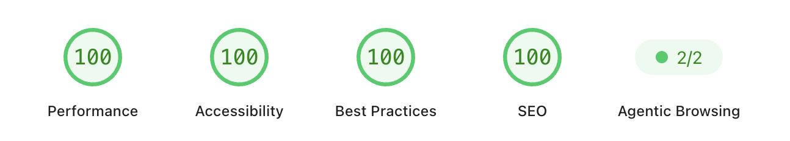

# matthieu.pm

The source code for [matthieu-pm.vercel.app](https://matthieu-pm.vercel.app/),
a lightweight personal portfolio for presenting projects, skills, selected
results, and contact information.

The website is built with Next.js and TypeScript in a Bun and Turborepo
monorepo. It is responsive, accessible, and optimized for fast loading.



## Features

- Responsive portfolio layout for desktop and mobile
- Project, skills, impact, and contact sections
- Downloadable résumé
- Optimized images and locally optimized Geist typography
- Vercel Analytics and Speed Insights
- Shared UI workspace configured for shadcn/ui components
- No environment variables or external database required

## MCP connection

The full text of every public page is available in matching `/llms.txt` and
`/llms-full.txt` exports, linked from the summary index at `/llms.md`. They also
include project profiles covering technology, architecture, features, product
decisions, and implementation boundaries. The editable profile source is
`apps/web/content/project-profiles.md`. Review it against the owning project
folders when their implementation changes.

To refresh the exports after changing site content or profiles, start the
local development server and run `bun run --cwd apps/web generate:llms-full`.
An optional URL argument selects another running instance. The generator uses
the sitemap and collection data, and writes the file only when all pages load.

The `/mcp` page explains how to connect an assistant to the public, read-only
Streamable HTTP endpoint at `https://matthieu.pm/mcp`. No account, API key,
database, or additional service is required.

- `search_collection`: keyword search and category browsing of the same JSON
  catalogues used by the design collection, with source links and pagination.
- `search_content`: keyword search across published skill guides and articles.
  An empty query lists their IDs without fetching the page text.
- `get_content`: read a published page as Markdown, with offsets for longer pages.

The server also exposes the collection and content index as MCP resources.
It uses the official MCP SDK in stateless JSON response mode, so requests can
run on different serverless instances. GET returns 405 because this server does
not provide a persistent event stream.

Published pages are explicitly listed in `apps/web/lib/site-content.ts`; drafts
and hidden pages are excluded. Collection changes are picked up from the existing
catalogues. Article metadata is shared with the writing pages. Full page text is
converted from the current deployment’s rendered HTML and cached for up to an
hour. External collection links are returned as references and never fetched.
Results report temporarily unavailable pages instead of inventing content.

To connect to a local development server, use `http://localhost:3001/api/mcp`.
To run protocol and content tests:

```bash
cd apps/web
bun run test:mcp
```

## Browser tools (WebMCP)

In browsers that support [WebMCP](https://webmachinelearning.github.io/webmcp/),
every page registers `search_collection`, `search_content`, `get_content`, and
`navigate_site` on page load. The read tools use the same schemas and validated
handlers as `/api/mcp`; navigation accepts only the published paths in its schema.
The adapter prefers `document.modelContext`, with a fallback for older browsers
that expose `navigator.modelContext`. Unsupported browsers continue normally.

Registration uses an AbortSignal to remove tools on cleanup or page exit. Tools
remain available across client-side navigation and register again when a page
returns from the browser's back/forward cache. Existing demo and feedback forms
also expose declarative tool metadata and require user review before submission.

Run `bun run test:webmcp` from `apps/web` to check discovery, execution, validation,
cancellation, and cleanup. To verify native discovery, enable WebMCP in a browser
that implements it and call `await document.modelContext.getTools()` after loading
the page. After deploying, scan the public URL with
`POST https://isitagentready.com/api/scan` and a JSON body of
`{"url":"https://matthieu.pm"}`; check `checks.discovery.webMcp.status` for `pass`.

## Technology

| Tool                                          | Purpose                                        |
| --------------------------------------------- | ---------------------------------------------- |
| [Next.js 16](https://nextjs.org/)             | Web framework and static rendering             |
| [React 19](https://react.dev/)                | User interface                                 |
| [TypeScript](https://www.typescriptlang.org/) | Type-safe development                          |
| [Bun](https://bun.sh/)                        | Package manager and script runner              |
| [Turborepo](https://turborepo.com/)           | Monorepo task orchestration                    |
| CSS Modules                                   | Component-scoped styling                       |
| [Vercel](https://vercel.com/)                 | Hosting, analytics, and performance monitoring |

## Getting started

### Requirements

- [Bun 1.3 or newer](https://bun.sh/docs/installation)
- Node.js 20 or newer

### Install and run locally

```bash
git clone https://gitlab.com/wondertale-dev/matthieu-pm.git
cd matthieu-pm
bun install
bun run dev
```

Open [http://localhost:3001](http://localhost:3001) in your browser.

## Available commands

Run these commands from the repository root:

| Command             | Description                                   |
| ------------------- | --------------------------------------------- |
| `bun run dev`       | Start the development server                  |
| `bun run build`     | Create a production build                     |
| `bun run lint`      | Check the code with ESLint                    |
| `bun run typecheck` | Check TypeScript types                        |
| `bun run format`    | Format TypeScript and TSX files with Prettier |

To preview the production build locally:

```bash
bun run build
cd apps/web
bun run start
```

## Project structure

```text
.
├── apps/
│   └── web/                    # Next.js portfolio application
│       ├── app/                # Page, layout, metadata, and styles
│       └── public/             # Images, logos, résumé, and icons
├── packages/
│   ├── eslint-config/          # Shared ESLint configuration
│   ├── typescript-config/      # Shared TypeScript configuration
│   └── ui/                     # Shared shadcn/ui components and styles
├── docs/                       # README assets
├── package.json                # Root scripts and workspace configuration
└── turbo.json                  # Turborepo task configuration
```

## Customizing the portfolio

The main files you will usually edit are:

- `apps/web/app/page.tsx` — portfolio text, links, projects, skills, and impact
- `apps/web/app/page.module.css` — page layout and component styles
- `apps/web/app/globals.css` — global colors and base styles
- `apps/web/app/layout.tsx` — metadata, font setup, analytics, and page shell
- `apps/web/public/` — images, logos, icons, and downloadable files

To use your own résumé, replace
`apps/web/public/matthieu-duchatellier-resume.pdf` and update its link in
`apps/web/app/page.tsx` if you choose a different filename.

To add a shadcn/ui component to the shared UI package:

```bash
bunx --bun shadcn@latest add button -c apps/web
```

Import shared components in the web application like this:

```tsx
import { Button } from "@workspace/ui/components/button"
```

## Deploying to Vercel

1. Import the repository into Vercel.
2. Select **Next.js** as the framework preset.
3. Set the root directory to `apps/web`.
4. Use `bun run build` as the build command.
5. Leave the output directory on the Next.js default.
6. Deploy the project.

The activity details use `ACTIVITY_DETAILS_URL`, the public URL of an aggregate
JSON file in Vercel Blob. The rest of the site works without it. After deployment,
enable Analytics and Speed Insights in the Vercel dashboard to collect their
respective metrics.

### Activity details sync

The collector requires Node.js 24. From `apps/web`, run `bun run activity:collect` to collect locally or
`bun run activity:sync` to collect and publish. `bun run activity:install` installs
a macOS LaunchAgent that runs at login and every five minutes while the Mac is
awake. `bun run activity:status` inspects it; `bun run activity:stop` stops it.

The collector scans GitHub/GitLab repositories under `~/Projects`, reading the
remote-tracking histories already present on this Mac. It counts commits authored
by the configured personal author names, including remote branches, and deduplicates
commit SHAs across mirrors and worktrees. Line totals are committed text changes;
binary files have no line count. Repositories not cloned here are not included.

Codex and Carbon records supply successful patch/file-edit counts and the most-used
model by completed turns. Repeated call/turn IDs are deduplicated. Shell-based edits
without structured patch calls are not counted as AI diffs. Neither source records
editor tab completions, so that metric is omitted.

Only weekly totals and model labels are published. Prompts, messages, paths,
repository names, commit SHAs, and call IDs remain local. The private cache and logs
live in `~/.local/share/matthieu-activity`. Uploads use the linked project's Blob
credentials through Vercel CLI; keep `.env.local` untracked. The website refreshes
expanded week statistics every minute, and the public blob cache lasts 60 seconds.

## Use it as a template

You may access, copy, modify, and use this website for free as a template for
your own portfolio. Replace the personal content, links, images, and résumé
with your own information before publishing it.

If you redistribute a substantial portion of the source, keep the original
copyright and license notice as required by the MIT License.

## License

This project is available under the [MIT License](LICENSE).
