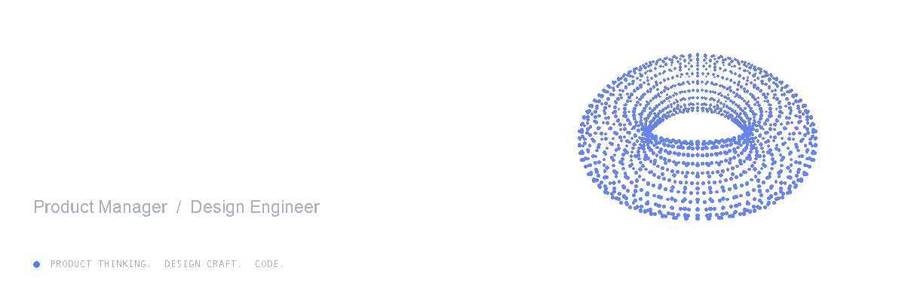
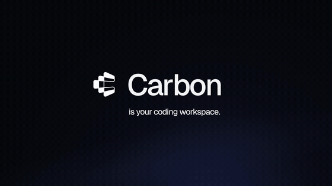
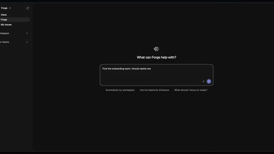
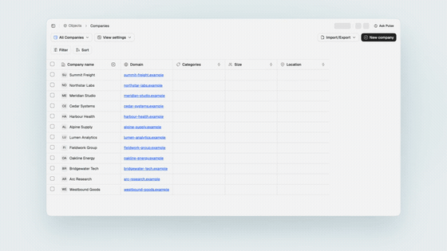
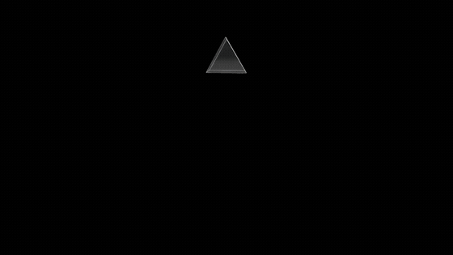

<a href="https://matthieu.pm">
  <picture>
    <source media="(prefers-color-scheme: light)" srcset="docs/profile/header-no-divider-light.gif" />
    
  </picture>
</a>

  <a href="https://matthieu.pm"><strong>Website ↗</strong></a> &nbsp; · &nbsp;
  <a href="mailto:mattduchatellier@gmail.com">Email</a> &nbsp; · &nbsp;
  <a href="https://x.com/matthieu_pm">X</a> &nbsp; · &nbsp;
  <a href="https://www.linkedin.com/in/matthieu-duchatellier/">LinkedIn</a> &nbsp; · &nbsp;
  <a href="https://gitlab.com/wondertale-dev">GitLab</a>

### Hi, I'm Matthieu.

I bring product thinking, design, and code together to build AI products. Making my own tools, like **Forge** and **Carbon**, has taught me a lot about engineering—and changed how I approach product and design.

I'm pursuing a **Product Management & UX Design MSc at SKEMA & POLIMI**. Previously, I co-founded **Wondertale**, a design studio I ran for two and a half years, and worked on growth and product design at **Avico** and **Xllence**.

**Open to Product Manager and Design Engineer roles starting June 2027.** [Let's talk →](mailto:mattduchatellier@gmail.com)

### Things I'm building

<table>
<tr>
<td width="50%" valign="top">

<h3><a href="https://carbonhq.sh">Carbon ↗</a></h3>

A desktop home for your coding agents. Conversations, worktrees, diffs, and browser sessions in one place.

Rust · Tauri · React · TypeScript

</td>
<td width="50%" valign="top">

<h3><a href="https://forgenow.tech/">Forge ↗</a></h3>

An agentic issue tracking workspace. Issues, planning, and agent-assisted work in one shared space.

TanStack Start · Neon Postgres · TypeScript

</td>
</tr>
<tr>
<td width="50%" valign="top">

<h3><a href="https://atrium-landing-tau.vercel.app/">Atrium ↗</a></h3>

Revenue teams meet agentic CRM workflows. Customer records, relationships, and next steps in a shared workspace.

Next.js · oRPC · TypeScript

</td>
<td width="50%" valign="top">

<h3><a href="https://matthieu.pm/inspirations">My collection ↗</a></h3>

A growing collection of tools and inspiring designs. Things worth keeping close when you're making something.

Next.js · Bun · Model Context Protocol

</td>
</tr>
</table>

### My workbench

**Interfaces** &nbsp; TypeScript · React · Next.js · TanStack Start 
**Under the hood** &nbsp; Rust · Tauri · Bun · Neon Postgres · oRPC 
**With agents** &nbsp; MCP · agent workflows · tools for builders

### A few things to explore

- **[/great-ui](https://matthieu.pm/skills/great-ui)** — a skill for building and polishing interfaces where every detail compounds.
- **[Write the interface](https://matthieu.pm/writing/ux-writing)** — my practical guide to clear, useful, consistent interface copy.
- **[My collection](https://matthieu.pm/inspirations)** — design references, components, tools, and people worth following.

---

  <a href="https://matthieu.pm">More of my work at <strong>matthieu.pm ↗</strong></a>

Looking for the portfolio source?

This repository also powers [matthieu.pm](https://matthieu.pm). The [development guide](docs/development.md) covers setup, architecture, scripts, and the site's public MCP endpoint. Profile artwork and GIFs live in [`docs/profile`](docs/profile); regenerate them with [`generate.py`](docs/profile/generate.py).

