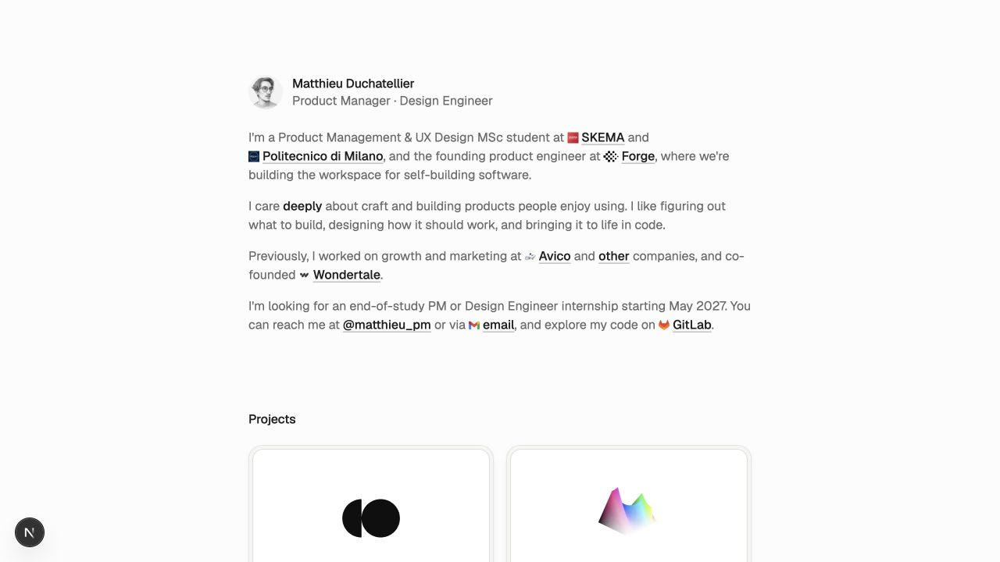
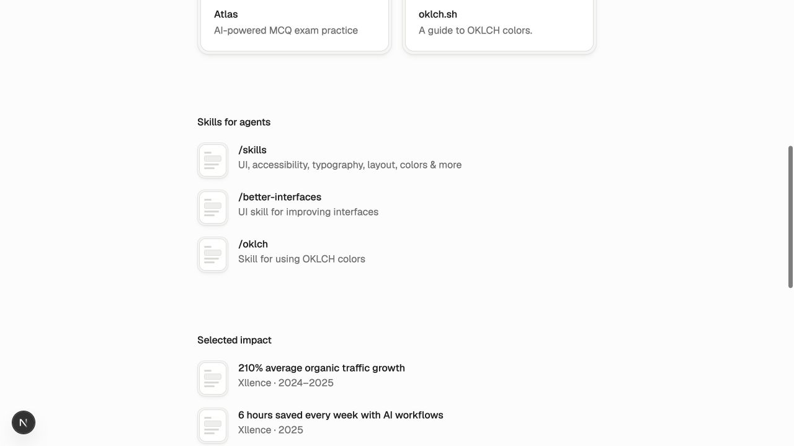
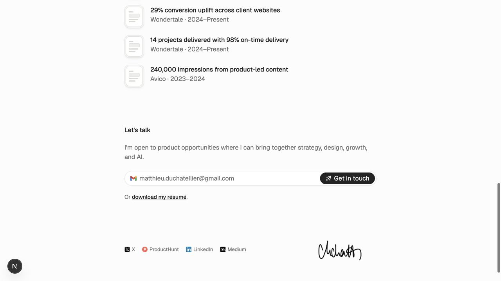
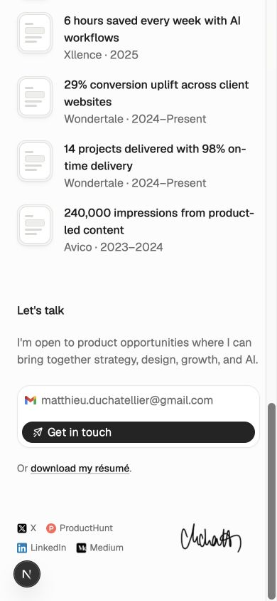
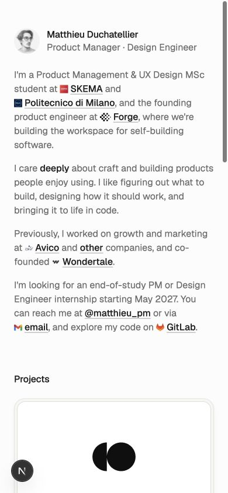

# Portfolio review — 7 September 2026

Scope: current local homepage at localhost:3001, source inspection, desktop 1280×720 and mobile 390×844. Individual skills pages excluded. No website code changed.

Verdict: the visual foundation is coherent and polished. Prioritize stronger evidence of personal contribution and easier recruiter scanning over a visual redesign.

## 1. Desktop introduction — good, positioning can be sharper

The opening leads with education before the founding product engineer role. Lead with the work and place education after it. Replace the vague LinkedIn link label “other” with an explicit destination. Keep the personal tone and understated typography.

## 2. Projects and impact — clear layout, insufficient context

Project cards name products and describe their purpose but do not explain personal ownership, status, or results. Add one short contribution line per project; a small product screenshot or concise example would help visitors assess design engineering ability without leaving the portfolio.

Impact figures need the action taken, measurement period and relevant baseline or denominator. Clarify whether 98% on-time delivery concerns milestones or deliverables, since the adjacent 14-project count does not explain the percentage. Prefer three well-supported examples over five isolated metrics. The identical document skeletons add little information to these outcomes; remove them or use meaningful company marks.

## 3. Desktop contact — clear, résumé too late

Email is already available in the introduction. The résumé is available only near the bottom, and LinkedIn is either hidden behind “other” or in the footer. Add explicit Email / Résumé / LinkedIn links near the opening. Align the closing invitation with the stated May 2027 internship search, or explicitly distinguish other opportunities if both are intended.

## 4. Mobile contact — readable, small primary target

No horizontal overflow at 390px (document scrollWidth equals innerWidth). The primary contact link is only 30px high; increase it toward 44px for easier tapping. Its content is left-aligned within a full-width pill; center it with flex alignment. The résumé and social links are also visually small; give standalone links more hit area.

## 5. Mobile introduction — sound reflow, slow access to work

At 390×844, Projects starts around y=674 and the first project's name falls below the opening viewport. Shorten the introduction and surface availability and recruiter links separately so work appears sooner. Preserve readable body text rather than shrinking it.

## Verification and limits

The local résumé URL returns HTTP 200. Both email links point to the same mailto address; no message was sent. Source includes heading structure, named sections, focus styles for primary links, reduced-motion handling, canonical metadata, social previews, robots and sitemap. This is not a complete accessibility or performance audit. Keyboard traversal, screen readers, résumé contents, external destinations and the deployed site were not validated. Do not interpret recommendations as observed conversion effects.

Priority: add contribution/evidence to projects and impact; improve opening and résumé access; then polish mobile targets and decorative impact icons.
